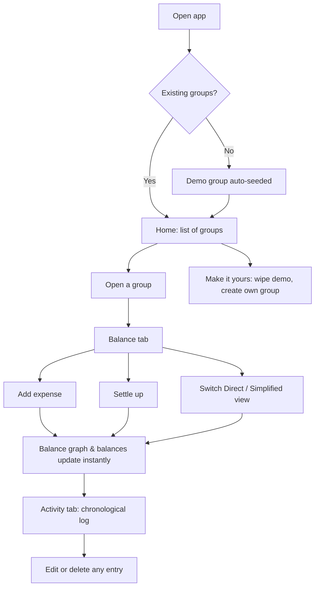
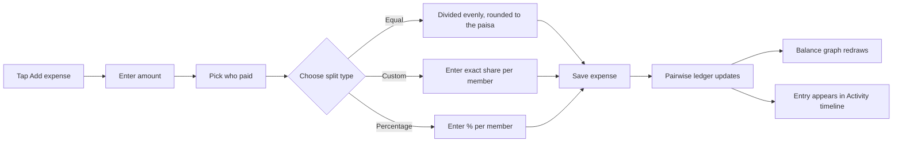
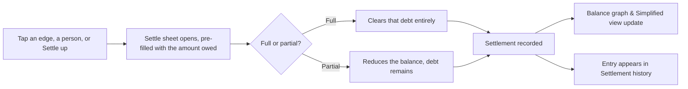
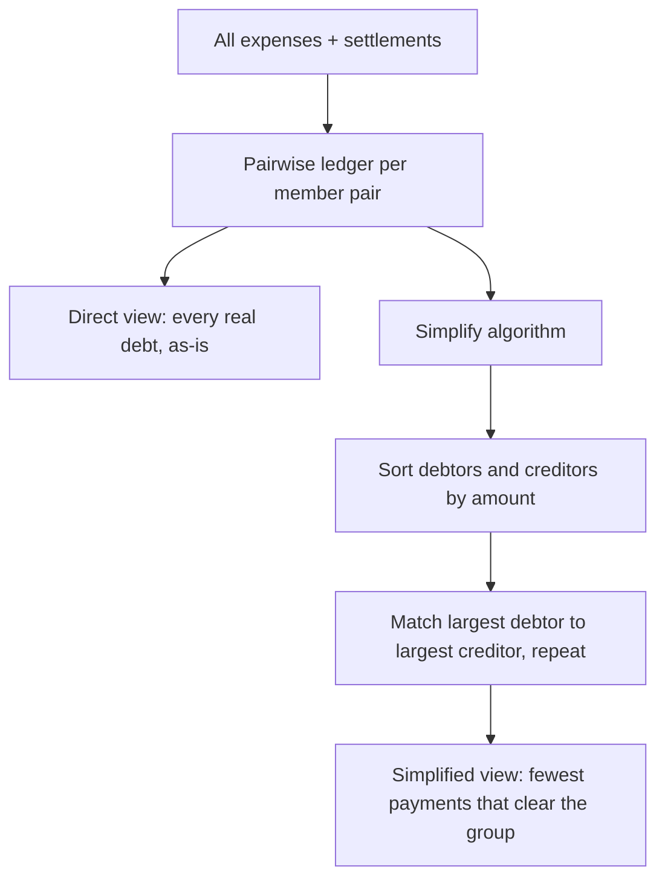

# Hisaab

**Who owes whom, at a glance.**

Hisaab is a lightweight, no-backend expense-splitting app for groups — trips, flatmates, dinners, anything shared. Log an expense, pick a split, and a live balance graph shows exactly who owes whom. No sign-up, no server: everything lives in the browser.

## Features

- **Groups & members** — create any number of groups, add or remove people at any time
- **Flexible splits** — equal, custom amounts, or percentage-based, per expense
- **Categories** — food, travel, stay, and misc, each with its own icon and color
- **Live balance graph** — an animated SVG graph of who owes whom, with "Direct" (every real debt) and "Simplified" (fewest payments to clear everyone) views
- **Settle up** — record full or partial payments; the graph and history update instantly
- **Activity timeline** — a chronological story of every expense and settlement, editable and deletable
- **Guided tour** — a built-in coach-mark walkthrough for first-time users, backed by seeded demo data
- **Zero backend** — all data is persisted to `localStorage`; nothing leaves the browser

## Tech stack

- [React 18](https://react.dev/) (UMD build, no bundler)
- [htm](https://github.com/developit/htm) — JSX-style templating without a build step
- [Tailwind CSS](https://tailwindcss.com/) via the Play CDN, with a custom theme (colors, fonts, shadows)
- Hand-rolled SVG for the balance graph, icons, and animations
- Fonts: Fraunces (display) and Instrument Sans (body), via Google Fonts

No build tooling, no package manager, no server — the app runs entirely as static files.

## Getting started

Clone or download the project and open `index.html` directly in a browser, or serve the folder with any static file server:

```bash
# Option 1 — just open it
open index.html

# Option 2 — serve it locally
npx serve .
```

That's it. The app seeds itself with a demo group ("Goa Trip") on first load so there's something to explore immediately.

## Project structure

```
.
├── index.html   # Entry point — CDN script tags, Tailwind config, and the app itself
├── app.js       # Application logic: components, state, money math, demo data
└── styles.css   # Custom CSS: form primitives, keyframe animations, range-input styling
```

## How it works

### Core concepts

| Concept | Description |
|---|---|
| **Group** | A collection of members, expenses, and settlements (e.g. "Goa Trip") |
| **Expense** | An amount, a payer, a category, and a split across members |
| **Split** | How an expense's cost is divided — `equal`, `custom`, or `pct` (percentage) |
| **Settlement** | A recorded payment between two members, full or partial |
| **Net balance** | What a member is owed (+) or owes (−) across the whole group |
| **Simplified debts** | The minimum set of payments that clears every balance, computed with a greedy largest-debtor-vs-largest-creditor algorithm |

### Money math, in short

Every expense updates a pairwise ledger between members. Settlements subtract from it. From that ledger, Hisaab derives:

1. **Direct edges** — real, person-to-person debts
2. **Net balance per member** — summed across all edges
3. **Simplified payments** — the fewest transactions that zero everyone out

Both views are rendered live on the same SVG balance graph.

## Tutorial walkthrough

This mirrors the app's built-in guided tour, which runs automatically over the seeded demo group.

### End-to-end user flow



### Logging an expense



### Settling a debt



### Direct vs. Simplified debts



## Data & privacy

Hisaab stores everything under a single `localStorage` key (`hisaab.v2`). There is no server, no account, and no network request involving your data — clearing the browser's storage for the page resets the app back to the seeded demo.

## Customization

- **Colors & fonts** — edit the `tailwind.config` block in `index.html`
- **Categories** — add or edit entries in the `CATS` object in `app.js`
- **Avatar palette** — the `AV` array in `app.js` controls member colors
- **Tour content** — edit `TOUR_STEPS` in `app.js` to change the onboarding copy
